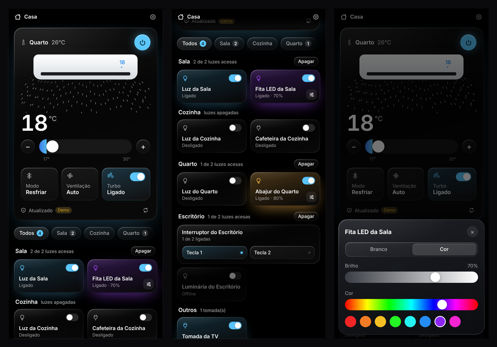
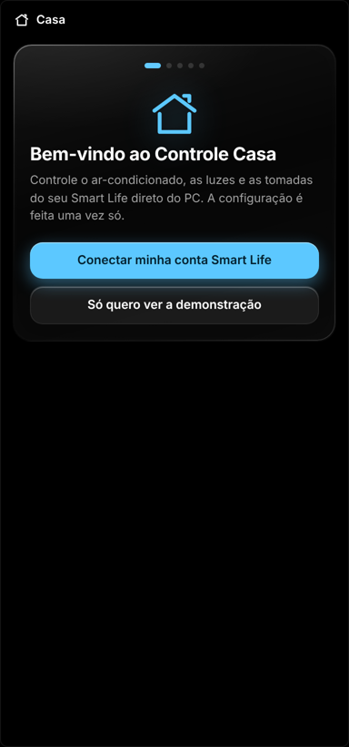
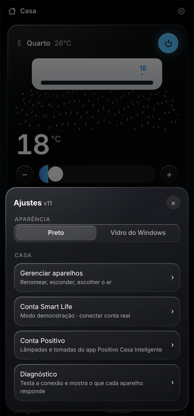
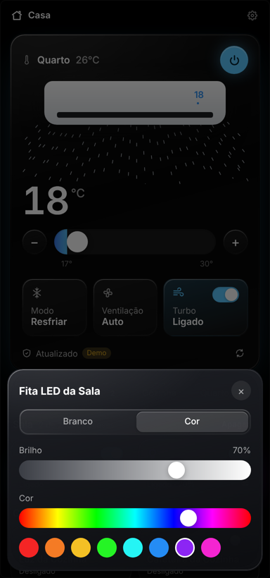

<div align="center">


# Controle Casa

**Controle o ar-condicionado, as luzes e as tomadas do Smart Life direto do PC.**
Um painel leve para Windows que fica na bandeja, ao lado do relógio.



</div>

---

## O que ele faz

- **Ar-condicionado**: liga e desliga, ajusta a temperatura, o modo, a ventilação e o turbo. Funciona com
  ar Wi-Fi e com ar comandado por **controle universal IR** do Smart Life. Cada ajuste vira um único
  comando, então o ar não fica apitando.
- **Luzes**: liga e desliga interruptores (inclusive os de várias teclas, cada tecla com seu botão) e
  lâmpadas inteligentes, com **brilho, branco quente/frio e cor**.
- **Tomadas inteligentes**: liga e desliga.
- **Cômodos**: agrupa tudo por cômodo, com filtro e um botão "Apagar" para cada cômodo, além do "Apagar tudo".
- **Bandeja do Windows**: uma casinha ao lado do relógio. Um clique abre o painel e o botão direito
  liga/desliga o ar e apaga as luzes. Uma bolinha azul aparece quando o ar está ligado.
- **Configuração guiada**: um assistente explica como criar a chave de acesso, testa a conexão e
  encontra sozinho todos os aparelhos da sua conta.
- **Positivo Casa Inteligente** (opcional): também controla lâmpadas e tomadas da Positivo, sem tirá-las
  do app da Positivo. A Alexa continua funcionando igual.
- **Visual**: fundo preto com cartões de vidro, ou o vidro acrílico do próprio Windows 11.
- **Demonstração**: dá para testar tudo sem conta nenhuma.

<details>
<summary><b>Mais telas</b></summary>
<br>
<p align="center">
  
  
  
</p>
</details>

## Requisitos

- Windows 10 ou 11.
- Uma conta no app **Smart Life** (ou Tuya Smart) com seus aparelhos.
- Uma conta gratuita na plataforma de desenvolvedor da Tuya. O assistente explica como criar.

## Instalação

### Opção 1: baixar o .exe (mais fácil)

1. Vá em **[Releases](../../releases)** e baixe o `ControleCasa.exe` mais recente.
2. Coloque onde quiser (Área de Trabalho, Documentos…) e abra.

> O Windows pode mostrar "O Windows protegeu o computador", porque o programa não tem assinatura
> digital paga. Clique em **Mais informações → Executar assim mesmo**.

### Opção 2: rodar pelo Python

1. Instale o [Python](https://www.python.org/downloads/) 3.10 ou mais novo e marque **"Add Python to PATH"**.
2. Baixe este repositório (**Code → Download ZIP**) e extraia.
3. Dê dois cliques em **`Iniciar.bat`**. Na primeira vez ele instala o que precisa.

Para gerar o seu próprio `.exe`, rode **`Gerar_EXE.bat`**. Ele fica em `dist\ControleCasa.exe`.

## Primeira configuração

O Smart Life não tem login direto para programas de terceiros. O caminho oficial é um projeto
gratuito na **Tuya**, a empresa por trás do Smart Life. Você faz isso uma vez só, e o assistente do
programa mostra os mesmos passos:

1. Crie uma conta em **[platform.tuya.com](https://platform.tuya.com)**.
2. Vá em **Cloud → Development → Create Cloud Project**:
   - *Industry*: **Smart Home** · *Development Method*: **Smart Home**
   - *Data Center*: **Western America** (o padrão para contas do Brasil)
3. Na tela de serviços, mantenha os que já vêm marcados e adicione o **IR Control Hub Open Service**.
   Ele é necessário para ar-condicionado por controle IR.
4. Na aba **Overview** do projeto, copie o **Access ID** e o **Access Secret** e cole no programa.
5. Na aba **Devices → Link App Account → Add App Account**, aparece um QR Code. No celular, abra
   **Smart Life → Eu → ícone de leitor (canto superior)** e escaneie.
6. O programa encontra seus aparelhos. Na última tela, renomeie, escolha os cômodos e esconda o que não quiser no painel.

> O serviço **IoT Core** da Tuya é gratuito, mas o período de teste expira de tempos em tempos. Se o
> programa parar de responder com uma mensagem sobre isso, entre na plataforma, vá em
> **Cloud → Cloud Services → IoT Core** e renove. Continua grátis.

## Usando

| Onde | O que fazer |
| --- | --- |
| Casinha na bandeja | Clique para abrir. Botão direito: ar, apagar luzes, **Iniciar com o Windows**, Sair |
| Botão **X** da janela | Só esconde. O programa continua na bandeja |
| Barra de cima ("Casa") | Arraste para mover a janela |
| Setas ↑ ↓ | Mudam a temperatura do ar |
| Botão de ajuste nos cartões das lâmpadas | Brilho, branco quente/frio e cor |
| ⚙ **Ajustes → Gerenciar aparelhos** | Renomear, esconder, escolher cômodo, nomes das teclas, qual é o ar, "meu ar só resfria", lista de cômodos |
| ⚙ **Ajustes → Diagnóstico** | Relatório do que cada aparelho responde e o botão **Testar o ar** |

Se a casinha ficar escondida na setinha `^` da bandeja, arraste-a para fora ou ligue em
**Configurações → Personalização → Barra de tarefas → Outros ícones da bandeja do sistema**.

### Cômodos

O programa adivinha o cômodo de cada aparelho pelo nome ("Luz da Cozinha" vai para a Cozinha) ou pelos
cômodos cadastrados no Smart Life. O que não der para adivinhar fica em **Outros**. Para mudar, use
**Ajustes → Gerenciar aparelhos**, onde também dá para editar a lista de cômodos.

### Ar-condicionado

- **Ar Wi-Fi** (aparece no Smart Life como ar-condicionado): o programa lê o estado real do aparelho.
- **Ar por controle IR**: cadastre o ar no seu controle universal pelo app Smart Life antes. O IR só
  envia, então se alguém mudar pelo controle físico, o painel não fica sabendo.
- Se o ar não responder, use **Ajustes → Diagnóstico → Testar o ar**. O programa tenta cada forma de
  comando que a Tuya aceita e passa a usar a que funcionar. O erro mais comum é faltar o
  **IR Control Hub Open Service** no projeto da Tuya.
- Se o seu ar não tem aquecimento, marque **"Meu ar só resfria"** em Gerenciar aparelhos.

### Positivo Casa Inteligente

Aparelhos da Positivo ficam numa conta separada do Smart Life e normalmente não pareiam nele. Em
**Ajustes → Conta Positivo**, entre com o e-mail e a senha do app da Positivo. As lâmpadas e tomadas
aparecem no painel e continuam funcionando no app da Positivo e na Alexa.

> ⚠️ Essa conexão **não é oficial**: o programa conversa com a nuvem do mesmo jeito que o app do
> celular. Se a Positivo mudar o app, ela pode parar de funcionar, e o programa avisa. O controle IR
> da Positivo ainda não tem botões no painel.

## Atualizando

- **.exe**: baixe o novo da página de Releases e substitua o antigo.
- **Python**: baixe o repositório de novo, extraia por cima da pasta antiga e rode **`Atualizar.bat`**.
  Ele fecha a versão aberta e abre a nova.

As configurações não se perdem, porque ficam fora da pasta do programa.

## Privacidade e segurança

- Tudo fica **no seu computador**, em `%APPDATA%\ControleCasa\config.json`. Não há servidor nosso
  nem coleta de dados. O programa só conversa com a nuvem da Tuya (e com a da Positivo, se você ligar).
- A senha da Positivo é guardada **protegida pelo Windows** (DPAPI) e só abre na sua conta de usuário.
- A interface funciona por um servidor local que só aceita conexões do próprio PC (`127.0.0.1`).
  Pedidos vindos de sites abertos no navegador são recusados.
- O relatório do Diagnóstico não inclui suas chaves nem sua senha.

## Problemas comuns

| Sintoma | O que fazer |
| --- | --- |
| "Sem permissão" | Confira se o app Smart Life está vinculado ao projeto (passo 5) e se os serviços estão autorizados |
| "O trial grátis do IoT Core expirou" | Renove em Cloud → Cloud Services → IoT Core |
| O ar não liga | Ajustes → Diagnóstico → **Testar o ar**. Normalmente falta o *IR Control Hub Open Service* |
| Nenhum aparelho aparece | Escaneie o QR (passo 5) com a **mesma conta** do Smart Life onde estão os aparelhos |
| A janela abriu, mas aparece "programa antigo ainda aberto" | Botão direito na casinha → Sair e abra de novo |
| Quero ver os erros | Rode `Depurar.bat` |

## Para quem quer mexer no código

| Arquivo | Função |
| --- | --- |
| `main.py` | Janela (pywebview/WebView2), bandeja (pystray), integração com o Windows |
| `core.py` | Configuração, nuvem Tuya, aparelhos, cômodos e servidor local |
| `positivo.py` | Conta Positivo Casa Inteligente (não oficial) |
| `index.html` | Interface inteira (HTML/CSS/JS, sem dependências) |

A interface usa uma API local em `http://127.0.0.1:8765`. Os pedidos `POST` precisam do cabeçalho
`X-Controle-Casa: 1`, o que dá para usar em atalhos ou num Stream Deck:

```
GET  /api/state                      estado do ar e dos aparelhos
POST /api/ac          {"power": true, "temp": 23, "mode": "cool", "fan": "auto", "turbo": false}
POST /api/device/ID   {"on": true} | {"brightness": 50} | {"temp": 30} | {"color": {"h": 270, "s": 100}}
POST /api/lights-off  {} ou {"room": "Sala"}
```

Os IDs dos aparelhos aparecem em `GET /api/state`.

## Créditos

- [tinytuya](https://github.com/jasonacox/tinytuya): acesso à nuvem da Tuya.
- [pywebview](https://github.com/r0x0r/pywebview), [pystray](https://github.com/moses-palmer/pystray) e [Pillow](https://python-pillow.org).
- O caminho da conta Positivo foi descoberto pelo projeto (arquivado)
  [homeassistant-positivo](https://github.com/rgsilva/homeassistant-positivo).

Este projeto não tem relação com Tuya, Smart Life, Positivo ou Amazon. Todas as marcas pertencem aos seus donos.

## Licença

[PolyForm Noncommercial 1.0.0](LICENSE.md) · © 2026 rodolfoxm.

- ✅ **Pode:** usar em casa, estudar, modificar e compartilhar, desde que **sem fins comerciais**.
  Escolas, ONGs e órgãos públicos também podem usar.
- ❌ **Não pode:** vender, incluir em produto ou serviço pago, nem usar para ganhar dinheiro sem autorização.
- Ao compartilhar, mantenha o arquivo de licença e a linha `Required Notice` junto.

Licenças comerciais são concedidas exclusivamente por **rodolfoxm**, mediante contato. Para isso,
abra uma *issue* ou fale pelo perfil [github.com/rodolfoxm](https://github.com/rodolfoxm).
